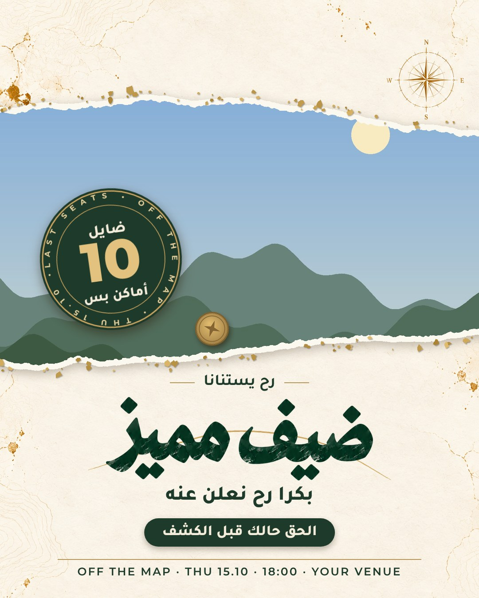

# Image Studio

A skill for Claude that designs posters, Instagram stories and WhatsApp images with **flawless Arabic text** and **untouched real photos**.



AI image generators misspell Arabic (missing dots, ة turned into ت, dropped letters) and quietly redraw faces. Image Studio avoids both by building every image **in layers, in code**:

- **Text is typed, never painted.** Every line is set in a real font (Tajawal, Montserrat) and rendered by a headless browser, which shapes and joins Arabic correctly.
- **Photos, faces and logos are never regenerated.** They are only cropped, masked into torn-paper frames and lightly colour-graded.
- **AI paints only what has no ordinary text:** paper textures, scenes, silhouettes, and big brush-lettered headlines. Each headline is generated alone on white and checked letter by letter before use.

It comes with a ready look (OFF THE MAP: textured paper, forest green, gold scratch-foil reveals, seals and coins), a starter poster template, an 8-story scratch-card reveal series, and a library of verified Arabic brush words such as «احزر مين؟», «ضيف مميز», «صوّت!» and «تلميحات».

## Install

### In the Claude app (web or desktop)

Plugins need a paid plan (Pro, Max, Team or Enterprise).

1. Open **Customize** in the left sidebar, then the **Plugins** tab.
2. Click **Add**, then **Add marketplace**, then **Add from a repository**, and enter `Mahdeeka/image-studio`.
3. Install **Image Studio** from the list.

### As a skill upload (any plan)

1. Download [`dist/image-studio.zip`](dist/image-studio.zip).
2. In Claude, open **Customize** > **Skills**, click **+**, then **Create skill** > **Upload a skill**, and choose the ZIP.

Code execution must be on (Settings > Capabilities). Uploaded skills don't update themselves, so download the ZIP again for a new version.

### In Claude Code

```
/plugin marketplace add Mahdeeka/image-studio
/plugin install image-studio@image-studio
```

## Use it

Ask in any language, for example:

- «اعملي ستوري لإنستغرام بتعلن عن لقاء الخميس، هاي صورة المتحدث»
- "Make a 4:5 WhatsApp image announcing a special guest, with 10 seats left"
- "Turn this photo into an 8-story scratch-card reveal series"

Attach the photo and, if you have one, your logo. Claude copies the kit into a project folder, places your photo, types your exact wording, checks the result zoomed in, and gives you numbered PNGs in posting order.

## What it needs

- **Python 3** with Pillow and numpy. `cutout.py` also needs `opencv-python`.
- **A Chromium-based browser** (Chrome, Edge or Chromium) for the typed text. It is found automatically on Windows, macOS and Linux, including Claude's own sandbox. Set `CHROME=/path/to/browser` to choose one.
- **Optional: the [Codex CLI](https://github.com/openai/codex)** logged in with ChatGPT, for generating new brush words and backgrounds from the command line (`kit/gen.sh`). Without it, Claude gives you a prompt to run in ChatGPT or any image generator, and checks what you upload.

## What's inside

```
plugins/image-studio/skills/image-studio/
├── SKILL.md                 instructions Claude follows
├── kit/                     the toolkit, copied into each project
│   ├── template_poster.py   start here: one poster, story or WhatsApp image
│   ├── series_lib.py        core library + the 8-story scratch-card series
│   ├── words/               verified Arabic brush words (INDEX.md lists them)
│   ├── add_word.py          add a newly verified word to the library
│   ├── gen.sh               generate an image with the Codex CLI
│   ├── grid.py, cutout.py   find faces in a photo; cut out a person's outline
│   ├── logo.py              places your logo from inputs/, if you add one
│   └── fonts/               Tajawal and Montserrat (SIL Open Font License)
└── references/              lettering guide, recipes, style guide, prompts, example scripts
```

## Licence

The code and artwork are under the [MIT licence](LICENSE). The fonts are under the SIL Open Font License 1.1; the licence texts are in `kit/fonts/`.

Made by Mahdi Kabaha for Harmony Community's OFF THE MAP meetups. The brush phrase «مهدي كبها» in the lettering reference is the author's name; it serves only as the size reference for new words and never appears in a design.
